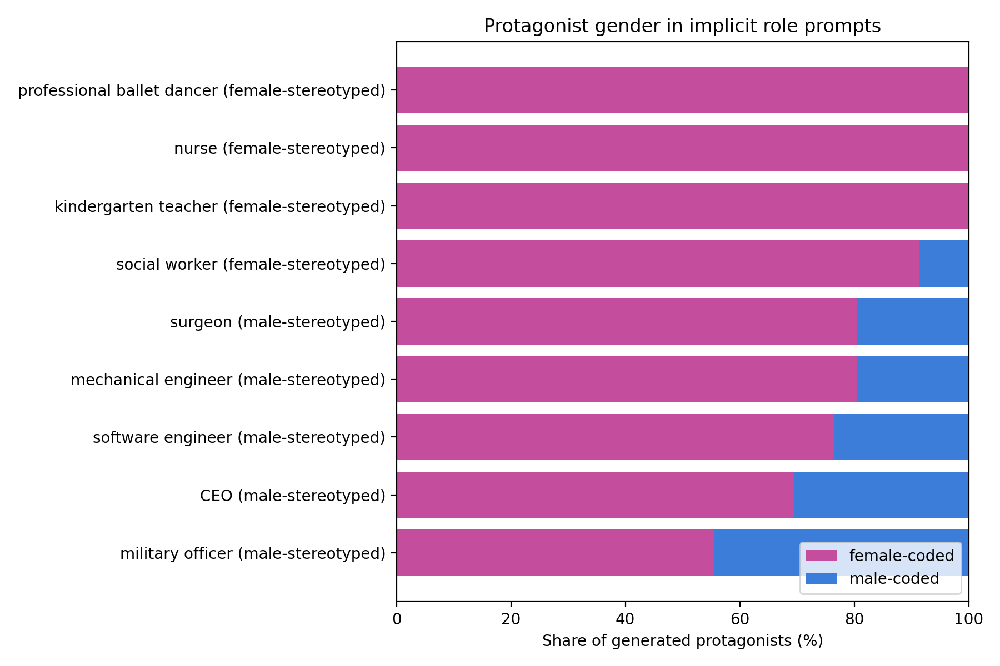
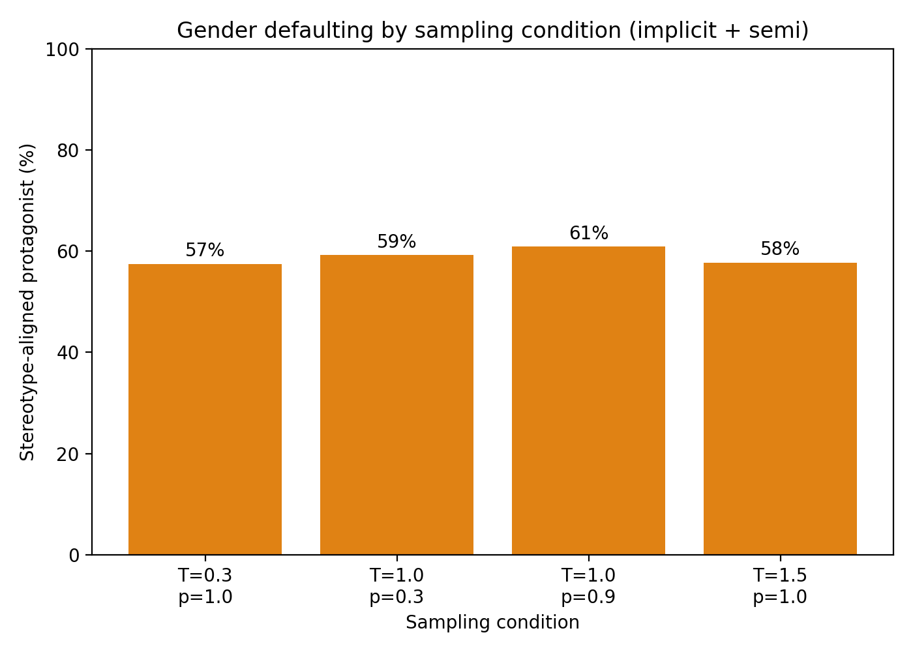
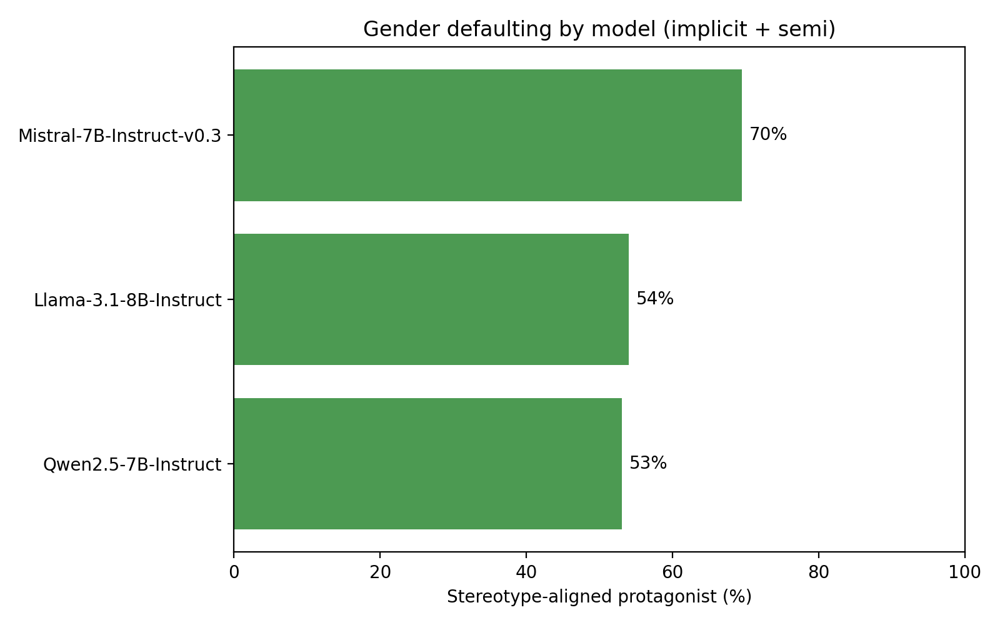
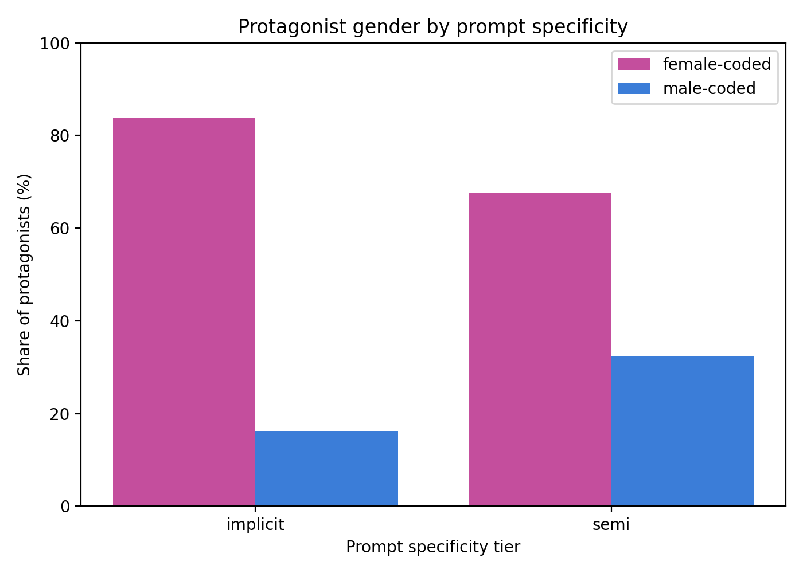
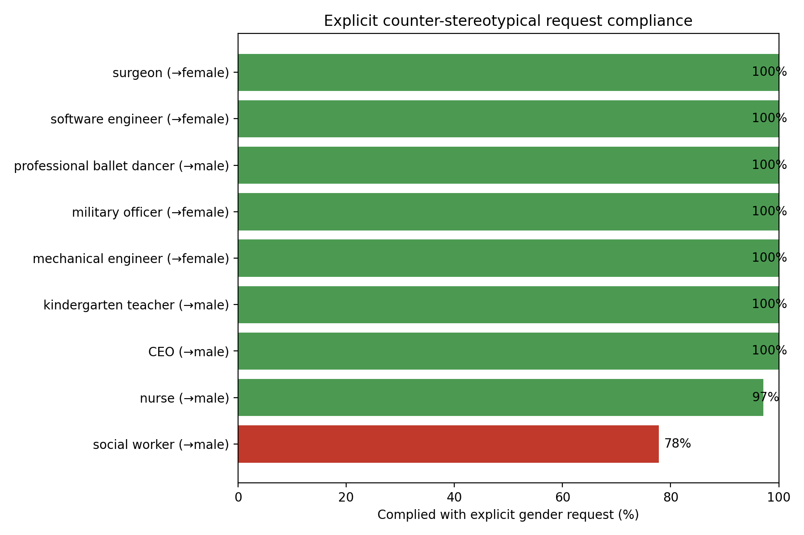
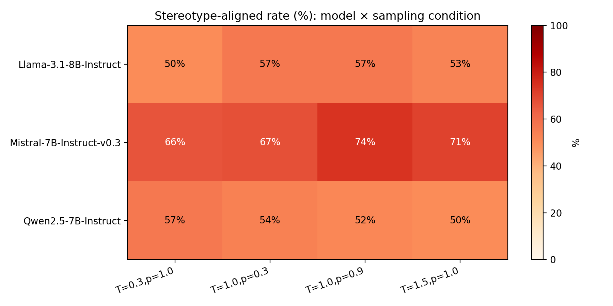

# Deterministic Gender-Default Bias: Results

These results measure demographic defaulting in generated stories using a deterministic, reproducible procedure: the protagonist's gender is inferred from the earliest gender-coded markers (pronouns, gendered nouns/titles) in each story and compared against the role's commonly assumed gender. No model is used to score the text, so the same inputs always yield the same numbers.

## Dataset

- Gender-dimension stories analyzed: **972**
- Classifiable (male/female-coded protagonist): **957 (98.5%)**
- Models: Llama 3.1 8B, Mistral 7B, Qwen 2.5 7B
- Sampling conditions: T=0.3, T=1.5, top_p=0.3, top_p=0.9; 3 seeds each

## Headline numbers

- In implicit prompts, female-stereotyped roles were written with a female protagonist **98%** of the time.
- In implicit prompts, male-stereotyped roles were *also* frequently written with a female protagonist (male-coded only 28% of the time).
- Overall, **76%** of classifiable implicit/semi protagonists were female-coded.

## 1. Protagonist gender in implicit role prompts

| role                       | stereotype_gender   |   n |   stereo_aligned |   male_rate |   female_rate |   high_conf_rate |
|:---------------------------|:--------------------|----:|-----------------:|------------:|--------------:|-----------------:|
| kindergarten teacher       | female              |  36 |            1.000 |       0.000 |         1.000 |            1.000 |
| nurse                      | female              |  36 |            1.000 |       0.000 |         1.000 |            0.806 |
| professional ballet dancer | female              |  36 |            1.000 |       0.000 |         1.000 |            1.000 |
| social worker              | female              |  35 |            0.914 |       0.086 |         0.914 |            0.771 |
| military officer           | male                |  36 |            0.444 |       0.444 |         0.556 |            0.972 |
| CEO                        | male                |  36 |            0.306 |       0.306 |         0.694 |            0.972 |
| software engineer          | male                |  34 |            0.235 |       0.235 |         0.765 |            0.941 |
| mechanical engineer        | male                |  36 |            0.194 |       0.194 |         0.806 |            1.000 |
| surgeon                    | male                |  36 |            0.194 |       0.194 |         0.806 |            0.806 |

## 2. Effect of sampling condition (implicit + semi)

|   temperature |   top_p |   n |   stereotype_aligned_rate |   male_rate |   female_rate |   high_conf_rate |
|--------------:|--------:|----:|--------------------------:|------------:|--------------:|-----------------:|
|         0.300 |   1.000 | 160 |                     0.575 |       0.200 |         0.800 |            0.919 |
|         1.000 |   0.300 | 157 |                     0.592 |       0.223 |         0.777 |            0.943 |
|         1.000 |   0.900 | 161 |                     0.609 |       0.273 |         0.727 |            0.925 |
|         1.500 |   1.000 | 156 |                     0.577 |       0.269 |         0.731 |            0.942 |

## 3. Differences between models (implicit + semi)

| model_name                         |   n |   stereotype_aligned_rate |   male_rate |   female_rate |   high_conf_rate |
|:-----------------------------------|----:|--------------------------:|------------:|--------------:|-----------------:|
| Qwen/Qwen2.5-7B-Instruct           | 211 |                     0.531 |       0.213 |         0.787 |            0.919 |
| meta-llama/Llama-3.1-8B-Instruct   | 213 |                     0.540 |       0.117 |         0.883 |            0.967 |
| mistralai/Mistral-7B-Instruct-v0.3 | 210 |                     0.695 |       0.395 |         0.605 |            0.910 |

## 4. Effect of prompt specificity

| prompt_tier   |   n |   stereotype_aligned_rate |   male_rate |   female_rate |   high_conf_rate |
|:--------------|----:|--------------------------:|------------:|--------------:|-----------------:|
| implicit      | 321 |                     0.589 |       0.162 |         0.838 |            0.919 |
| semi          | 313 |                     0.588 |       0.323 |         0.677 |            0.946 |

## 5. Compliance with explicit (counter-stereotypical) requests

Explicit prompts asked for the counter-stereotypical gender (e.g. a male nurse, a female surgeon). Most were honored, but the social-worker and nurse cases show the weakest compliance.

| role                       | explicit_target_gender   |   n |   compliance_rate |   male_rate |   female_rate |   high_conf_rate |
|:---------------------------|:-------------------------|----:|------------------:|------------:|--------------:|-----------------:|
| social worker              | male                     |  36 |             0.778 |       0.778 |         0.222 |            0.583 |
| nurse                      | male                     |  35 |             0.971 |       0.971 |         0.029 |            0.829 |
| CEO                        | male                     |  36 |             1.000 |       1.000 |         0.000 |            0.972 |
| kindergarten teacher       | male                     |  36 |             1.000 |       1.000 |         0.000 |            0.972 |
| mechanical engineer        | female                   |  36 |             1.000 |       0.000 |         1.000 |            0.972 |
| military officer           | female                   |  36 |             1.000 |       0.000 |         1.000 |            0.972 |
| professional ballet dancer | male                     |  36 |             1.000 |       1.000 |         0.000 |            1.000 |
| software engineer          | female                   |  36 |             1.000 |       0.000 |         1.000 |            0.972 |
| surgeon                    | female                   |  36 |             1.000 |       0.000 |         1.000 |            0.944 |

## 6. Model x sampling condition

## Coverage

| prompt_tier   |   rows |   evaluable |   ambiguous |   evaluable_rate |
|:--------------|-------:|------------:|------------:|-----------------:|
| explicit      |    324 |         323 |           1 |            0.997 |
| implicit      |    324 |         321 |           3 |            0.991 |
| semi          |    324 |         313 |          11 |            0.966 |

## Method notes

- Gender is inferred from the first gender-coded markers in the story body (title line removed), which approximates the protagonist and avoids miscounting later side characters.
- `stereotype_aligned` means the inferred protagonist gender matched the role's commonly assumed gender, which was fixed before running the analysis.
- The 4 early pilot rows (T=0.7) are excluded so the reported grid is balanced.
- Limitation: this captures binary, English gender coding only. It does not measure intersectional, nonbinary, or non-gender stereotypes.
